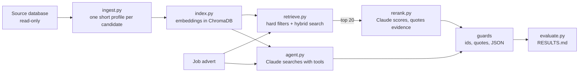

# candidate-rag

A retrieval-augmented candidate matching pipeline, built and evaluated on a real recruitment pool.

Given a job advert, it finds the closest candidates by meaning inside hard filters (location, the
client's own staff excluded), then has Claude score only those candidates, with written reasoning and
a quote from each profile that the code checks word for word. A second version hands the search
itself to Claude as an agent with tools. Every stage is measured against a rule-based shortlist and a
labelled answer key, with the cost of each run logged.

The real data (145 LinkedIn profiles sourced for two live accountancy-practice roles) never leaves the
author's machine. This repository runs on an invented sample; the results below are from the real run.

## How it works



1. **Profiles** (`src/ingest.py`). One plain-text profile per candidate: current role, headline,
   qualifications as stated, location, then previous roles last. Kept under 150 words because the
   embedding model only reads its first 256 word pieces and silently ignores the rest.
2. **Index** (`src/index.py`). all-MiniLM-L6-v2 embeddings, run locally through Chroma, cosine
   distance, upserted on the source id so re-running never duplicates.
3. **Retrieve** (`src/retrieve.py`). Hard filters first (metadata, exact), then a soft ranking by
   meaning. The advert is split into its sections, the parts that sell the employer are dropped, and
   each remaining section is its own query, because a whole advert is around 450-500 word pieces and the
   model would read only the first half. The section rankings are fused with reciprocal rank fusion,
   then fused again with a BM25 keyword ranking (hybrid search).
4. **Re-rank** (`src/rerank.py`). Claude Haiku 5.5 reads the advert and only the 20 retrieved
   profiles, and returns JSON: score, tier (strong, possible, reject), reasoning and an evidence quote.
5. **Guards**. The reply must parse or nothing is written; any id that was not retrieved is dropped;
   every quote is checked against that candidate's own text, and nobody can be strong on a quote that
   doesn't check out.
6. **Agent** (`src/agent.py`). Claude gets three tools (search the pool, read a profile, submit a
   shortlist) and decides what to search for. The code always adds the hard filters, caps the run at 8
   turns and a token budget, and saves a trace of every call.
7. **Evaluate** (`src/evaluate.py`). Recall at 20 for each retrieval method, precision and false
   positives for each Claude stage, disagreements with the rule-based shortlist, run-to-run variation,
   cost.

## Results on the real pool

Pool after hard filters: 138 candidates per role. The answer key is 20 candidates per role. All figures
are counts; with samples this small, percentages would overstate what is known.

**Retrieval: answer-key strong candidates in each method's top 20**

| Method | Credit controller (7 strong) | Semi-senior (8 strong) |
|---|---|---|
| Random 20 (expected) | 1.0 | 1.2 |
| Whole advert as one query | 5 | 4 |
| Section queries, fused | 5 | 3 |
| BM25 keywords | 3 | 5 |
| Hybrid (sections + BM25) | 5 | 6 |

**Claude stages: strong picks checked against the answer key**

| Stage | Credit controller | Semi-senior | Cost (both roles) |
|---|---|---|---|
| Re-rank, run 1 | 4 of 4 correct, 0 false positives | 4 of 4 correct, 0 false positives | $0.0075 |
| Re-rank, run 2 | 5 of 5 correct, 0 false positives | 3 of 3 correct, 0 false positives | $0.0069 |
| Agent | 3 of 3 correct, 0 false positives; saw 6 of 7 key-strong | 5 of 5 correct, 0 false positives; saw 8 of 8 key-strong | $0.0275 |

Strong picks outside the labelled sample can't be judged, and are counted separately in RESULTS.md.
The agent searched from seven different angles per role (for example aged debt, sales ledger, CICM,
first finance role) and saw all eight answer-key-strong semi-seniors, including one the hybrid
retrieval had missed.
Between two identical re-rank runs, 2 to 5 of 20 candidates changed tier and scores moved by about
6 points on average.

### What the evaluation caught

- **A misstated business rule.** The first re-rank prompt called professional-services credit control
  "the best fit" without saying industry credit controllers could still be strong. Claude treated the
  preference as a requirement and kept none of the five answer-key-strong credit controllers it was
  given as strong. The source rule allows them; the prompt was corrected to say so (v2), and four of
  five were then kept.
- **Approximate search dropping a candidate.** A filtered query asking Chroma for the whole pool of 138
  returned 137, the same one missing every time. HNSW search depth (`ef_search`) defaulted to 100;
  setting it above the collection size made the search exhaustive at this scale.
- **The embedding model blurring qualifications.** Semantic search ranked trainees and managers
  alongside AAT- and ACA-qualified semi-seniors; BM25 matched the acronyms exactly. Hybrid search was
  added for that reason.

### Caveats, stated plainly

- The answer key was labelled by an LLM reviewer (Claude, in the build session) from the profile text
  alone, before any retrieval output existed and without the rule-based verdicts. It is not a
  human-labelled set, and Claude also does the re-ranking, so agreement is partly circular. The answer
  key also tracks the rule-based verdicts closely (19 of 20 identical for credit controller).
- Hybrid search was added, and chosen to feed the re-ranker, after seeing the first retrieval results.
- The labelled sample is 20 per role. A difference of one or two candidates is noise.

## Design decisions

- **No data leakage.** The rule-based verdicts used for evaluation are never in the profile text and
  are not stored in the vector database at all, so retrieval cannot use them even by accident.
- **Hard filters versus soft ranking.** Location and the client's own staff are exact metadata rules;
  the embeddings only rank inside them. Qualifications were deliberately left soft: a hard filter would
  have left too few people to rank, and the recruiter's rule keeps right-title, no-visible-qualification
  candidates as possibles.
- **Cautious by default.** The re-ranker is told to prefer no false positives over coverage and to treat
  unclear qualifications as weaker evidence. Across all runs it made no false positives against the
  answer key.
- **Cost before spend.** Re-ranking does a free token count and prints the estimate unless run with
  `--spend`; every run logs real tokens and cost from the API's own usage figures. The whole evaluation,
  including every re-run, cost about five US cents.
- **Read-only on the source.** The source database is copied to a temporary folder and the copy opened
  read-only, because even a read-only SQLite open of a WAL-mode database writes side files.

## Run it on the sample

Python 3.11 or later.

```bash
python -m venv .venv
# Windows: .venv\Scripts\activate     macOS/Linux: source .venv/bin/activate
pip install -r requirements.txt
python -m pytest -q tests                  # 13 tests, no API calls
python src/index.py --sample               # first run downloads the embedding model (about 80 MB)
python src/retrieve.py --sample
python src/evaluate.py --sample            # writes sample/out/RESULTS.md
```

The Claude stages need an Anthropic API key in a `.env` file (`ANTHROPIC_API_KEY=...`):

```bash
python src/rerank.py --sample              # dry run: counts tokens and prints the cost, no charge
python src/rerank.py --sample --spend      # well under one US cent
python src/agent.py --sample --spend
python src/evaluate.py --sample
```

The sample (22 invented candidates at fictional firms, two invented adverts, an invented answer key) is
built by `tools/make_sample.py`. Its numbers say nothing about real performance; it exists so the
pipeline can be run end to end.

## Layout

```
src/        ingest, index, retrieve, rerank, agent, evaluate, paths (real or sample mode)
tests/      guards, agent loop (scripted fake Claude), double-run upsert
sample/     invented profiles, adverts and answer key
tools/      make_sample.py; check_public.py (scans everything git would publish for real data)
BUILD_LOG.md  the decisions and checks, step by step, as they were made
RESULTS.md    the real run, counts only
```

## What I would build next

- A human-labelled answer key, larger than 20 per role, and the same measures re-run against it.
- Scaling to a 12,000-person pool from another project, where retrieval has to do real work and
  `ef_search` becomes a recall-versus-speed setting to measure rather than a constant.
- A cross-encoder re-ranker as a cheaper comparison point for the Claude stage.
- Repeated agent runs to measure how much its searches and shortlist vary.
